<br>

> med student by day. d3veloper by n1ght. sl33p is 0ptional.

### 存在 &nbsp;// wh0 am 1

i study medicine and write code when the city goes quiet.
backend first, frontend when it has to look right, low-level things when i can't sleep anyway.

### 記録 &nbsp;// t1meline

| | |
|:--|:--|
| `2022 — 2028` | medical university |
| `2024` | account takeover vulnerability in MPAY (Azerbaijan) |
| `oct 2026` | vulnerability in CloPOS |
| `oct 2026` | vulnerability in WhatsApp guest calls (new feature) |
| `nov 2026 — aug 2027` | [Locus](https://locus-sechenov.ru/) — Engineering of Digital Products and Intelligent Systems |

### 解体 &nbsp;// r3verse

i take things apart to see how they really work. most of the vulnerabilities
i've found came out of reverse engineering — reading minified bundles,
watching traffic, and following a protocol until it does something it
shouldn't. account takeover, auth bypass, logic flaws in flows that were
supposed to be closed. [ploom-rs](https://github.com/buttovvskiii/ploom-rs)
is the public, friendly side of the same habit: a whole device protocol
recovered from an app that shipped no docs.

### 知能 &nbsp;// a1 &amp; llm

i build with language models, not just prompt them. comfortable with tokens
and context windows, RAG, tool calling and the Model Context Protocol (MCP),
multi-step agents, skills, hooks and plugins — the moving parts of an agentic
system and how they fit together.

### 言語 &nbsp;// langu4ges

| | | |
|:--|:--|:--|
| 🇦🇿 | Azerbaijani | `native · C2` |
| 🇷🇺 | Russian | `C2` |
| 🇬🇧 | English | `B1` |
| 🇩🇪 | German | `A1` |

### 道具 &nbsp;// st4ck

```text
languages   JavaScript, TypeScript
runtime     Node.js, Bun
backend     Elysia.js, Express, Fastify, REST API, WebSockets
data        PostgreSQL, MongoDB, Prisma ORM, Drizzle ORM, Mongoose
telegram    GramJS, grammY
frontend    React / Next.js, Vue, Svelte 5 / SvelteKit, HTML, CSS, SCSS, Tailwind, Bootstrap
tooling     Git, Docker, CI/CD
learning    Rust
```

### 作品 &nbsp;// w0rk

**[ploom-rs](https://github.com/buttovvskiii/ploom-rs)** — a desktop app and CLI for the Ploom Aura, built on a
reverse-engineered Bluetooth protocol. Rust, Tauri, Svelte, three.js.

<a href="https://github.com/buttovvskiii/ploom-rs">
  
</a>

<br>

<p align="center"><sub>「眠れない夜にコードを書く」<br>n0thing is f1ne. sh1p it anyway.</sub></p>
